# Gem Merchant · The Lustrous Trade Route

**A Splendor-based fan board game with Greek god powers, an Oracle race mode, and online play — fully bilingual (English / 中文).**

> 《宝石商人 · 诸神篇》——以 Splendor 规则为底、叠加希腊神技与神谕竞速的同人桌游，支持中英文一键切换。

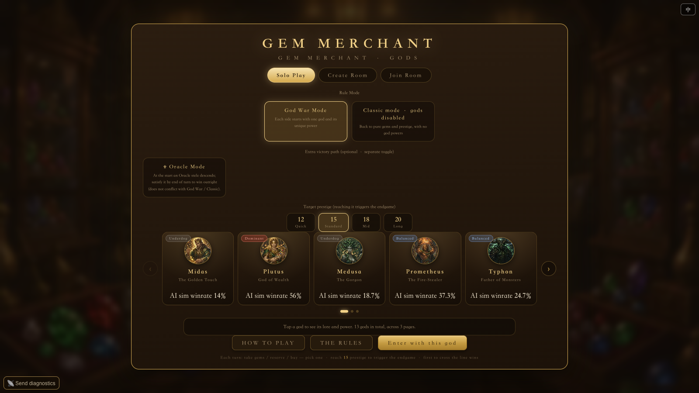

**Features / 特性**

- **13 gods, 13 unique powers** — Golden Touch, fire-theft, card burial, color locks, gold swapping…
  **13 位神祇、13 种独门神技**——点石成金、盗火、埋底、封色、换金……
- **5 Oracle race objectives** that layer on top of any rule set (Color Collection / High Mastery / Noble Favor / Rainbow / Divine Goldmine)
  **5 种神谕竞速目标**，可叠加在任意规则模式之上
- **60 cards + 11 nobles**, all with individually AI-generated art; **16 music tracks** that react to lobby / oracle / endgame
  **60 张卡牌 + 11 位贵族**，全部 AI 独立插画；**16 首配乐**随大厅、神谕、终局切换
- **Server-authoritative multiplayer** (SSE push + POST actions, zero npm dependencies)
  **服务端权威联机**（SSE 推送 + POST 动作，零第三方依赖）
- **Single-file frontend** — `index.html` inlines all JS/CSS and packs assets as data URIs
  **单文件前端**——`index.html` 内联全部 JS/CSS，资源全部打包为 data URI
- **DOM-layer i18n** — the Chinese source strings *are* the translation keys; not a single one of the 850+ game-code call sites was modified
  **DOM 层国际化**——中文原文即翻译 key，850+ 处游戏代码调用点一行未改
- **Full English UI** via a live 中 / EN toggle (top-right corner, persisted)
  **完整英文界面**，右上角 中/EN 按钮实时切换（本地记忆）

---

## Screenshots · 截图

<details>
<summary><b>Lobby & setup · 大厅与开局</b> (click to expand)</summary>

**Main lobby (Chinese) · 主大厅（中文）**
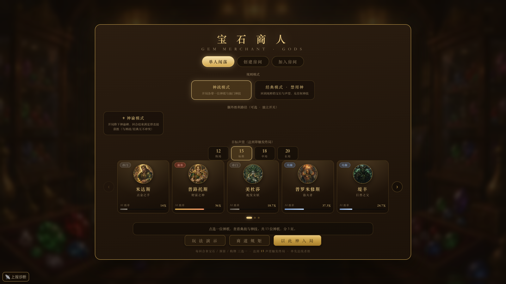

**God detail panel · 神祇详情（米达斯）**
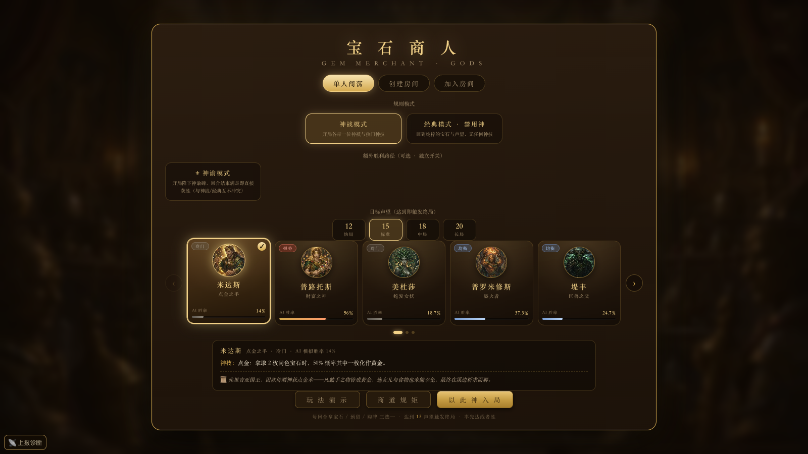

**Oracle mode selection · 神谕模式选择**
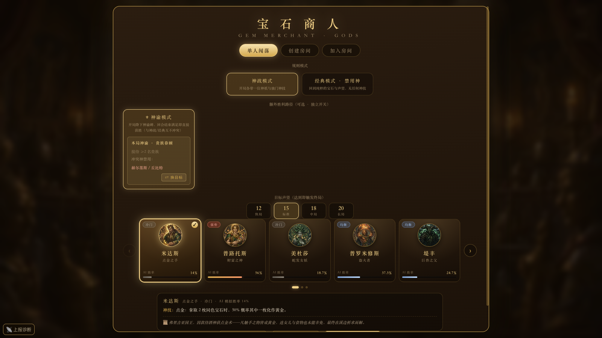

**Create room · 创建联机房间**
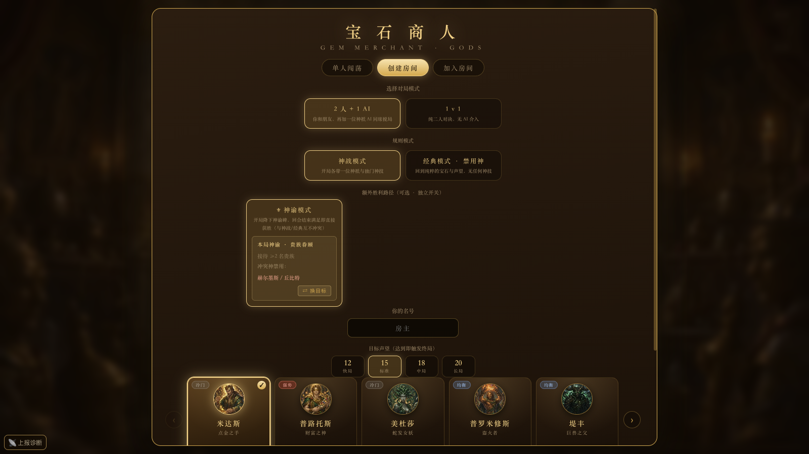

**Join room · 加入房间**
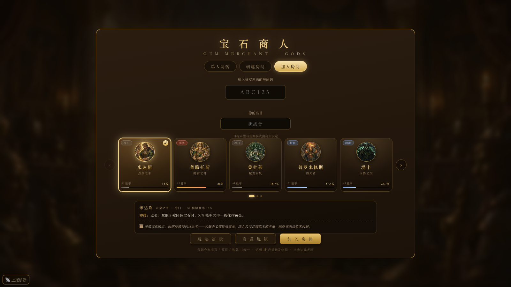

</details>

<details>
<summary><b>Rules & tutorial · 规则与教学</b></summary>

**"The Rules" handbook (1/2) · 商道规矩（上）**
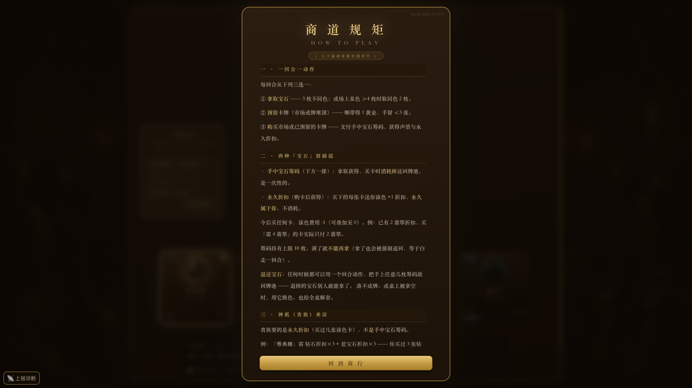

**"The Rules" handbook (2/2) · 商道规矩（下）**
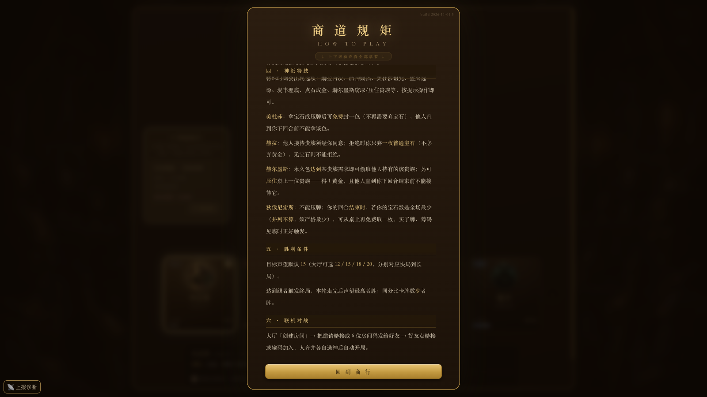

**Interactive play demo · 玩法演示**
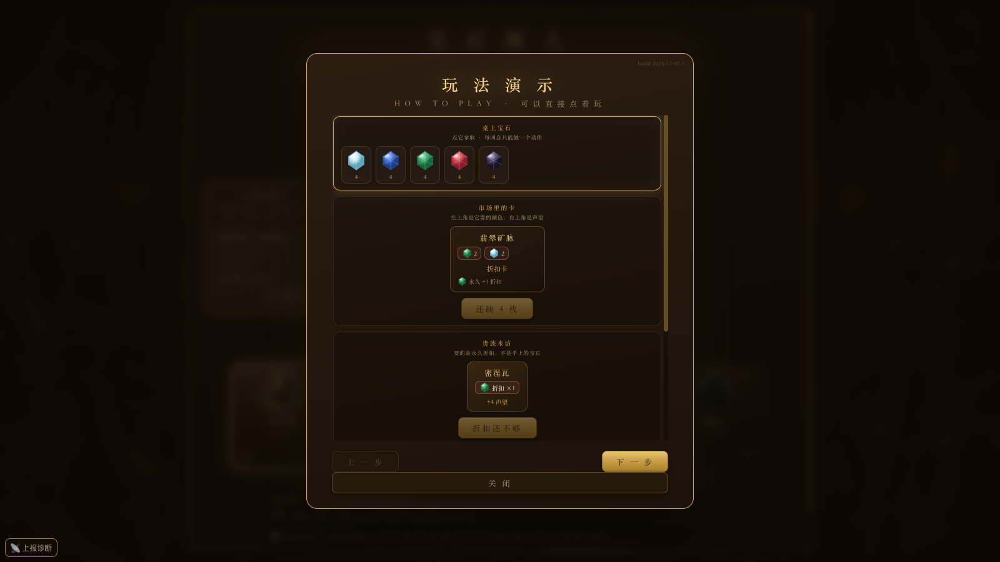

</details>

<details>
<summary><b>Game boards — every mode · 各模式棋盘</b></summary>

**God War mode · 神战模式** (each side starts with one god and its power · 开局各带一位神祇与神技)
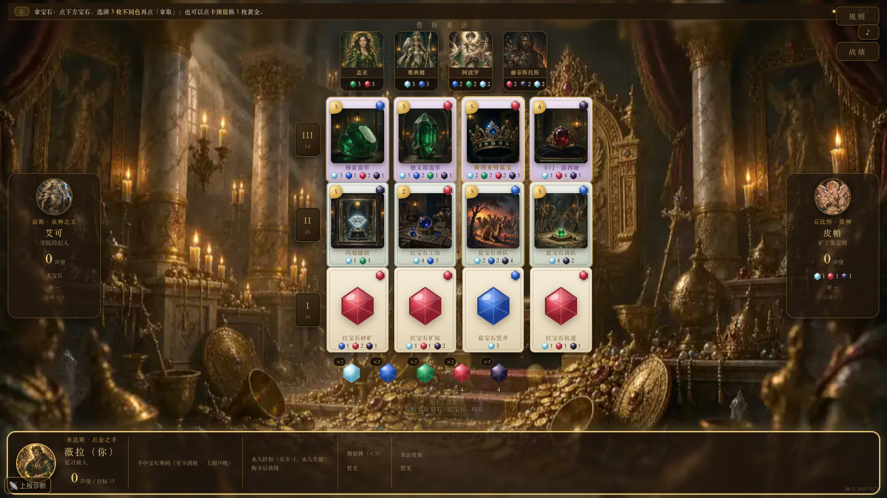

**Classic mode · 经典模式** (gods disabled — pure gems & prestige · 禁用神技，纯粹资源博弈)
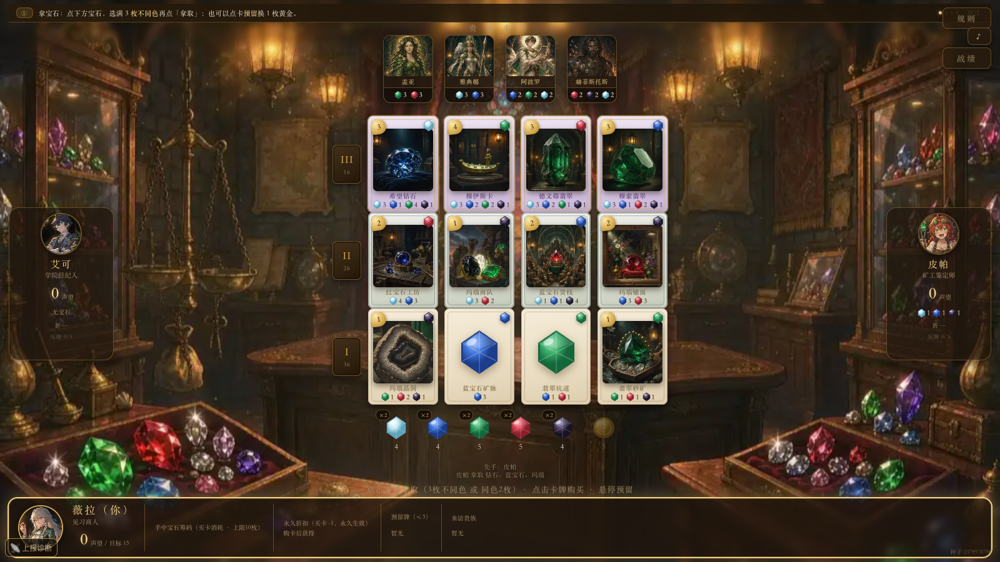

**Oracle mode · 神谕模式** (the oracle stele sits top-right; satisfy it to win outright · 右上角神谕碑，达成即胜)
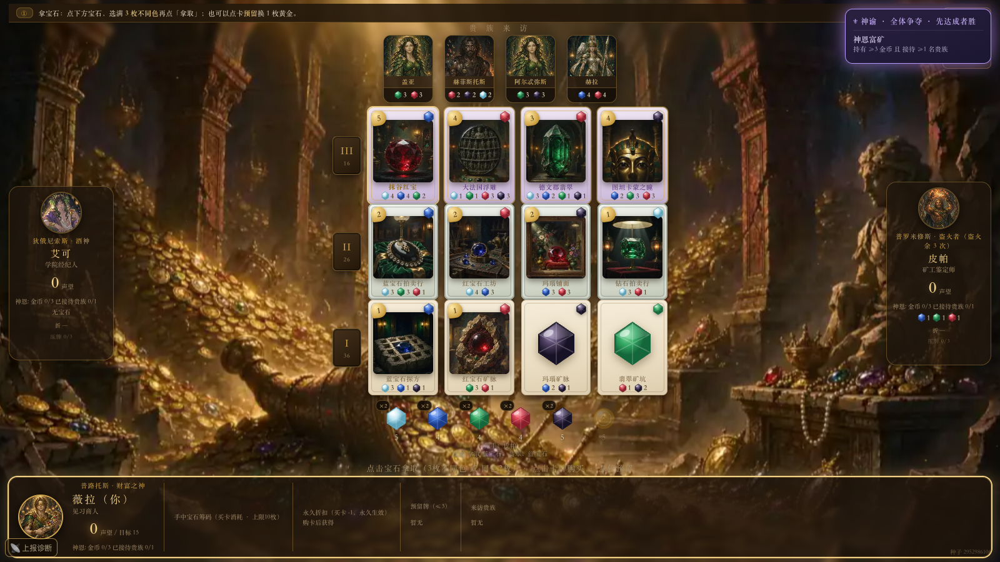

</details>

<details>
<summary><b>Online play & records · 联机与战绩</b></summary>

**Waiting room with room code · 带房间码的等待页**
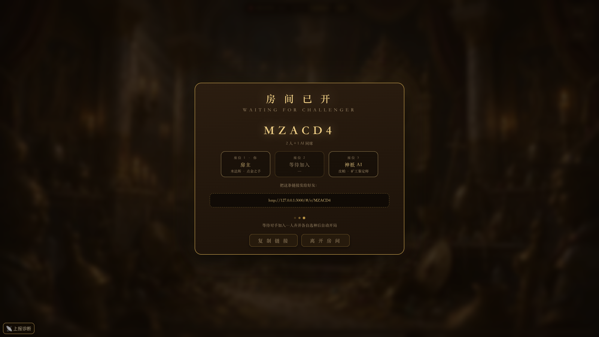

**Records / stats screen · 战绩页**
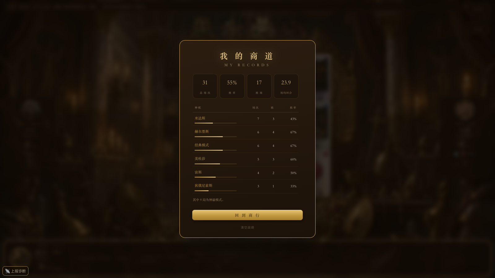

</details>

**English UI · 英文界面** (zero residual Chinese — verified by an automated text-node scan · 经文本节点自动扫描验证零中文残留)

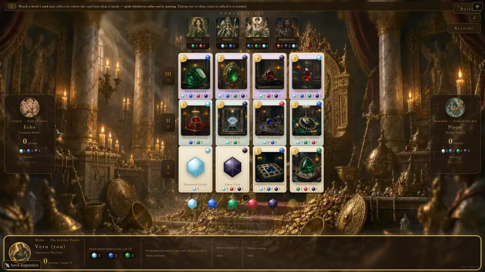

---

# English

## Quick Start

Requires Node.js ≥ 18. **No npm dependencies at all.**

```bash
git clone https://github.com/ssslumdunk-star/gem-merchant-gods.git
cd gem-merchant-gods
npm start            # or: PORT=8090 node server.js
```

Open `http://localhost:3000` and play.

- Solo play runs entirely **in the browser** — you can also just double-click `index.html`.
- Online rooms need `server.js` running.
- Switch language any time with the **中 / EN** button at the top-right corner.
- Sound needs one user gesture first (click anything) — browsers block autoplay otherwise.

---

## Rules — detailed

*Base rules follow Splendor (by Marc André); rules themselves are not copyrightable. This is an independent, non-commercial fan implementation.*

### The goal

Be the player with the **highest prestige (VP)** when the game ends. The prestige target is selectable before you start: **12 / 15 / 18 / 20** (default 15).

1. The first player to **reach the target triggers the endgame**.
2. The **current round finishes** so nobody is cut mid-turn.
3. Highest prestige wins; **a tie is broken in favour of the player holding fewer cards**.

### Setup

- **3 players**: you (*Vera — Apprentice Merchant*), plus AI rivals *Echo — Academy Broker* and *Pippa — Mining Assayer*. Online, the host opens a room as **2 humans + 1 AI** or **1v1**, then shares the room link / 6-char code; the friend picks their own god too.
- Market: 4 face-up cards per level × 3 levels, 11 nobles above the board, a gem pool of 5 colors (4 each in a 3-player game) + gold.

### Your turn — exactly one action

**1. Take gems**
- Take **3 gems of different colors**, or
- take **2 gems of the same color** if at least 4 of that color are on the table.
- Gold is never taken from the pool — you earn it by reserving (below) or from god powers.
- If this pushes you over the **10-token hand limit**, you must return tokens immediately.

**2. Reserve a card**
- Take a face-up card (or the top card of a deck) into your hand: **max 3 reserved**, and you gain **1 gold**.
- Reserved cards are public information; when you buy one you still get its permanent discount.
- If your tokens are already at 10 you get no gold (nothing to gain).

**3. Buy a card**
- Pay the card's gem cost **minus your permanent discounts** in those colors (gold counts as a wild token).
- You gain the card's **prestige** and a **permanent +1 discount** in each color the card lists. Discounts are never spent — they are your engine for the rest of the game.
- Buying also unlocks **nobles**: their requirements are counted in *permanent discounts* (cards bought per color), not gems in hand. Nobles visit **automatically at the end of your turn**, grant **+4 prestige**, and cost you no action.

### God powers (God War mode)

At the start you pick one of **13 gods**; its power reshapes your whole strategy — some are economic (Midas, Plutus), some are hate-drafting (Hera, Hermes, Medusa), some rewrite the action economy (Prometheus, Typhon, Dionysus). Every god card in the lobby shows its **AI-simulated win rate** so balance is visible before you commit.

### Oracle mode (optional extra victory path)

An **oracle stele** descends at the start of the game. It is an **independent toggle**: you can stack it onto God War *or* Classic. The first player to satisfy the oracle **wins outright**, and gods that would trivially break an oracle are auto-banned for that game.

### Classic mode

All god powers disabled — pure gem-and-prestige Splendor. The best mode for newcomers.

---

## The Thirteen Gods

Win rates are from the bundled AI simulation (3 evenly-seated players; baseline ≈ 33%) and are displayed in the lobby.

| God | Title | Power | AI win |
|---|---|---|---|
| **Midas** 米达斯 | The Golden Touch 点金之手 | When you take 2 of one color, 50% chance one of them turns to gold. | 14% |
| **Plutus** 普路托斯 | God of Wealth 财富之神 | Hold the most gems for 2 turns running (ties count) → your next purchase costs 1 less. | 56% |
| **Medusa** 美杜莎 | The Gorgon 蛇发女妖 | After taking gems or reserving, lock one color for free: until your next turn nobody else may take it. | 18.7% |
| **Prometheus** 普罗米修斯 | The Fire-Stealer 盗火者 | Cannot reserve. 3 times per game: when buying, name a face-up card and its gem bonus counts as yours this turn (not valid for nobles). | 37.3% |
| **Typhon** 堤丰 | Father of Monsters 巨兽之父 | Cannot reserve. Whenever you buy, bury a same-level face-up card and refill the market. | 24.7% |
| **Phaethon** 法厄同 | The Sun-Chariot 太阳战车 | Must take a full set of 3 different colors — but afterwards you may discard one to gain a gold. | 30% |
| **Cupid** 丘比特 | God of Love 爱神 | Cannot receive nobles; whenever another player receives one, you gain 2 prestige. | 24% |
| **Zeus** 宙斯 | King of the Gods 众神之王 | Cannot buy level-1 cards; buying level 2/3 costs 1 less (once every 5 turns). | 63.3% |
| **Hera** 赫拉 | Queen of the Gods 天后 | Nobody may receive a noble without your approval; declining blocks them for the turn and gives you 1 prestige. | 17.3% |
| **Poseidon** 波塞冬 | God of the Sea 海神 | Cannot take two of one color; once per turn, if only 1 of a color remains on the table you may take it free. | 21.3% |
| **Hades** 哈迪斯 | God of the Underworld 冥王 | Cannot reserve; if every other player holds reserved cards, your purchases cost 1 less. | 68.7% |
| **Hermes** 赫尔墨斯 | The Messenger & Thief 信使与窃贼 | If your permanent colors satisfy a noble's requirement, steal it from its holder; or pin a noble for 1 gold — untouchable until your next turn. | 14% |
| **Dionysus** 狄俄尼索斯 | God of Wine 酒神 | Cannot reserve; at end of your turn, if you strictly hold the fewest gems, take one more from the table. | 48% |

## The Five Oracles

| Oracle | Requirement | Difficulty |
|---|---|---|
| **Color Collection** 颜色收藏 | ≥4 cards in **each** of any 2 colors | Hard 高 |
| **High Mastery** 高阶掌控 | ≥4 level-3 cards | Hard 高 |
| **Noble Favor** 贵族眷顾 | Host ≥2 nobles | Medium 中 |
| **Rainbow Collection** 彩虹收藏 | ≥2 cards in **all 5** colors | Hard 高 |
| **Divine Goldmine** 神恩富矿 | Hold ≥3 gold **and** host ≥1 noble | Medium 中 |

---

## Highlights & design innovations

1. **Asymmetric god powers with visible balance data.** 13 gods each bend a different rule of the base game (economy, hate-drafting, action economy), and the lobby shows each one's AI-simulated win rate — balance isn't a hidden spreadsheet, it's on the card you're about to pick.

2. **The Oracle layer is a composable win condition.** Rather than a separate "mode", the oracle is an independent toggle that stacks onto God War *or* Classic, auto-banning gods whose powers would trivialize the objective. One rule set, four ways to play.

3. **One pure-function rules engine, two runtimes.** `logic.js` (`newGame` / `legalActions` / `applyAction`) has no side effects: single-player runs it directly in the browser, online play runs the *same file* on the server. The rules can never diverge between modes, and `server.js` only does rooms + broadcast.

4. **Server-authoritative netcode without a framework.** SSE for state pushes, `POST` for actions, room codes for matchmaking — zero npm dependencies, ~one file, runs anywhere Node ≥ 18 runs.

5. **A single-file frontend.** `index.html` inlines every script and style and embeds all art/audio as data URIs — the whole game is one portable file that still runs offline (solo mode needs no server at all).

6. **DOM-layer i18n: Chinese *is* the key.** Instead of re-plumbing 850+ string call sites into `t("...")` lookups, the runtime treats the Chinese text already in the DOM as the key and translates in place:
   - 4-level fallback: whole-HTML-block match → exact text match → regex patterns (for template strings like `X 拿取 A、B`) → longest-first word substitution;
   - a `MutationObserver` re-translates anything the game renders after boot (log lines, pop-ups, re-renders);
   - the original Chinese is cached per text node, so toggling **EN → 中** restores it byte-for-byte;
   - the dictionary is *generated* by `tools/build_i18n_en.py` from the collector dumps (`i18n_collected.json`) + `i18n_data.json`, and a TreeWalker scan over raw text nodes asserts **zero residual Chinese** in English mode.

7. **AI-generated art and adaptive music.** Card art, noble portraits, god art and backgrounds are individually generated (prompts preserved in `card_manifest.json` / `card_prompts.json`); 16 tracks rotate in the lobby, switch per oracle theme, and sting on win/loss. Fonts are LXGW WenKai (OFL).

---

## Architecture

```
.
├── index.html          # single-file frontend (all JS/CSS inlined, data-URI assets)
├── logic.js            # pure-function rules engine (shared by browser & server)
├── server.js           # authoritative server (rooms + SSE push + POST actions)
├── i18n_core.js        # DOM-layer translation engine (fallback chain + observer + toggle)
├── i18n_en.js          # generated English dictionary (window.I18N_DATA)
├── tools/build_i18n_en.py   # dictionary builder (collector dumps → i18n_en.js)
├── assets/
│   ├── audio/          # 16 tracks (.m4a primary / .mp3 fallback)
│   ├── clean/          # card illustrations
│   └── god_bg/         # god background art
├── fonts/              # LXGW WenKai subset (OFL, see fonts/OFL.txt)
├── screens/            # README screenshots
├── *_test.js           # balance & regression tests
└── backups/            # pre-inline backup of index.html
```

- **Audio** ships in two formats: AAC (`.m4a`, ~54% of mp3 size) with automatic mp3 fallback on old browsers.
- The **中/EN toggle** writes `localStorage.gem_lang` and re-renders through `translateTree` / `restoreTree`.

## Tests

```bash
node balance_gods_fair.js      # win-rate spread across gods
node classic_replay_test.js    # rules-engine regression
node sim_audit.js              # simulation audit (source of the lobby win rates)

PORT=8090 node server.js &     # then, for DOM flow tests:
node dom_test.js
```

---

# 中文版

## 快速开始

需要 Node.js ≥ 18，**无任何 npm 依赖**。

```bash
git clone https://github.com/ssslumdunk-star/gem-merchant-gods.git
cd gem-merchant-gods
npm start            # 或 PORT=8090 node server.js
```

浏览器打开 `http://localhost:3000` 即可游玩。

- 单人模式完全跑在**浏览器端**，直接双击 `index.html` 也能玩。
- 联机房间需要 `server.js` 在运行。
- 右上角 **中 / EN** 按钮随时切换语言（本地记忆）。
- 浏览器策略要求先有一次点击才会出声，进游戏先点一下。

## 玩法说明（详细）

*基础规则同 Splendor（Marc André 设计）；规则本身不受版权保护，本作为独立实现的非商业同人作品。*

### 胜利条件

终局时**声望（VP）最高者胜**。开局前可选目标声望：**12 / 15 / 18 / 20**（默认 15）。

1. **率先达到目标声望者触发终局**；
2. **当前轮次走完**，不打断任何人的回合；
3. 声望最高者胜；**同分时比卡牌数，少者胜**。

### 开局配置

- **3 名玩家**：你（*薇拉 — 见习商人*），对手 AI *艾可 — 学院经纪人*、*皮帕 — 矿工鉴定师*；联机时房主可开 **2 人 + 1 AI** 或 **1v1** 房局，把房间链接／6 位房间码发给好友即可加入，好友同样自选神祇。
- 桌面：三个等级各 4 张明牌、桌上 11 位贵族、5 色宝石池（3 人局每色 4 枚）+ 黄金。

### 回合动作——三选一

**① 拿宝石**
- 拿 **3 枚不同色**；或当某色桌上 **≥4 枚**时拿 **2 枚同色**。
- 黄金不能从池里拿——靠「预留」或神技获得。
- 手上宝石超过 **10 枚上限**必须立即退还。

**② 预留卡牌**
- 把一张明牌（或牌堆顶）收进手里：**最多 3 张**，同时**得 1 枚黄金**。
- 预留的牌对所有人可见；之后买下仍获得永久折扣。
- 宝石已满 10 枚时不给黄金。

**③ 购买卡牌**
- 支付卡面费用**减去该色永久折扣**（黄金可当任意色）。
- 获得卡牌**声望**，并获得卡面各色 **+1 永久折扣**——折扣永不消耗，是整局最重要的资产。
- 购买会推进**贵族**需求（贵族看的是永久折扣即各色买牌数，不是手里的宝石）：回合结束自动结算，满足即来访 **+4 声望**，不占你的行动。

### 神技（神战模式）

开局自选 13 位神祇之一，神技会彻底改变打法：有的偏经济（米达斯、普路托斯），有的偏干扰（赫拉、赫尔墨斯、美杜莎），有的直接改写行动经济（普罗米修斯、堤丰、狄俄尼索斯）。大厅每张神卡都标注 **AI 模拟胜率**，平衡性开箱可见。

### 神谕模式（可选额外胜利路径）

开局降下**神谕碑**。它是**独立开关**，可叠加在神战*或*经典之上；率先完成神谕目标者**直接获胜**，会破坏该神谕的神祇当局自动禁用。

### 经典模式

禁用全部神技，回归纯粹的宝石与声望——最适合新手。

## 十三位神祇

胜率来自内置 AI 模拟（3 人均势座位，基线 ≈33%），大厅内可见。

| 神祇 | 神技 | AI 胜率 |
|---|---|---|
| **米达斯** · 点金之手 | 拿 2 枚同色宝石时，50% 概率其中一枚化作黄金。 | 14% |
| **普路托斯** · 财富之神 | 连续 2 回合保持全场宝石最多（含并列），买牌少付 1 枚。 | 56% |
| **美杜莎** · 蛇发女妖 | 拿宝石或压牌后可免费封一色：至你下回合，他人不得拿该色。 | 18.7% |
| **普罗米修斯** · 盗火者 | 不能压牌；限 3 次，买牌时指定一张明牌，本回合视作拥有其宝石奖励（对贵族无效）。 | 37.3% |
| **堤丰** · 巨兽之父 | 不能压牌；每次买牌可将一张同级明牌埋底并补新。 | 24.7% |
| **法厄同** · 太阳战车 | 拿宝石必须拿满 3 种不同色；拿满后可弃 1 枚换 1 金。 | 30% |
| **丘比特** · 爱神 | 不能接待贵族；他人接待贵族时你获得 2 声望。 | 24% |
| **宙斯** · 众神之王 | 不能购买 1 级牌；买 2、3 级牌少付 1 枚（每 5 回合一次）。 | 63.3% |
| **赫拉** · 天后 | 他人接待贵族须经你同意；你拒绝则其本回合不能接待，你获 1 声望。 | 17.3% |
| **波塞冬** · 海神 | 不能拿两枚同色；每回合一次，某色桌上仅剩 1 枚可免费拿走。 | 21.3% |
| **哈迪斯** · 冥王 | 不能压牌；若其他角色全部都有压牌，买牌少付 1 枚。 | 68.7% |
| **赫尔墨斯** · 信使与窃贼 | ① 永久色满足某贵族需求即可从他人手中偷取；② 可压住一位贵族得 1 金，他人至你下回合结束前不能接待。 | 14% |
| **狄俄尼索斯** · 酒神 | 不能压牌；回合结束时若你宝石数严格最少，可再免费取 1 枚。 | 48% |

## 五种神谕

| 神谕 | 达成条件 | 难度 |
|---|---|---|
| **颜色收藏** | 任意 2 色各 ≥4 张卡 | 高 |
| **高阶掌控** | 拥有 ≥4 张 3 级卡 | 高 |
| **贵族眷顾** | 接待 ≥2 名贵族 | 中 |
| **彩虹收藏** | 5 色各 ≥2 张卡 | 高 |
| **神恩富矿** | 持有 ≥3 金币 **且** 接待 ≥1 名贵族 | 中 |

## 创新点

1. **非对称神技 + 可见的平衡数据。** 13 位神各自撬动基础规则的一个支点（经济／干扰／行动经济），大厅直接公示 AI 模拟胜率——平衡不是藏起来的表格，而是你选神前就看得到的数字。
2. **可组合的神谕胜利层。** 神谕不是「又一个模式」，而是独立开关，可叠加在神战*或*经典之上，并自动禁用会破坏目标的神祇——一套规则、四种玩法。
3. **同一套纯函数引擎、两个运行时。** `logic.js`（`newGame` / `legalActions` / `applyAction`）零副作用：单人直接在浏览器跑，联机由服务端跑**同一个文件**——规则永不双轨，`server.js` 只管房间与广播。
4. **无框架的服务端权威联机。** SSE 推状态、`POST` 发动作、房间码匹配——零 npm 依赖，一个文件，凡能跑 Node ≥ 18 的地方都能跑。
5. **单文件前端。** `index.html` 内联全部 JS/CSS，美术与音频打包为 data URI——整个游戏是一个可携带的单文件，离线也能玩（单人模式完全不需要服务端）。
6. **DOM 层 i18n：中文即 key。** 不把 850+ 处调用点改成 `t("...")`，而是让运行时把 DOM 里已有的中文直接当 key就地翻译：
   - 四级回退：整块 HTML 匹配 → 精确文本匹配 → 正则模板（`X 拿取 A、B` 这类）→ 按长度降序的词表替换；
   - `MutationObserver` 自动翻译启动后渲染的一切（日志、弹窗、重绘）；
   - 每个文本节点缓存中文原文，**EN → 中** 可逐字还原；
   - 词典由 `tools/build_i18n_en.py` 从采集数据自动生成，TreeWalker 裸文本扫描断言英文模式下**零中文残留**。
7. **AI 美术 + 自适应配乐。** 卡牌、贵族、神祇与背景逐张生成（提示词留存于 `card_manifest.json` / `card_prompts.json`）；16 首配乐大厅轮换、按神谕换主题、胜负结算变奏。字体为霞鹜文楷（OFL）。

## 目录结构

```
.
├── index.html          # 单文件前端（JS/CSS 内联，data URI 资源）
├── logic.js            # 纯函数规则引擎（前后端共用）
├── server.js           # 权威服务端（房间 + SSE + POST）
├── i18n_core.js        # DOM 层翻译引擎（回退链 + 观察器 + 切换）
├── i18n_en.js          # 生成的英文词典（window.I18N_DATA）
├── tools/build_i18n_en.py  # 词典生成器（采集数据 → i18n_en.js）
├── assets/audio|clean|god_bg
├── fonts/              # 霞鹜文楷子集（OFL）
├── screens/            # README 截图
└── *_test.js           # 平衡与回归测试
```

## 测试

```bash
node balance_gods_fair.js      # 各神胜率分布
node classic_replay_test.js    # 规则引擎回归
node sim_audit.js              # 模拟审计（大厅胜率来源）

PORT=8090 node server.js &     # 之后可跑 DOM 流程测试：
node dom_test.js
```

---

## Credits & license

| Asset | Source | License |
|---|---|---|
| Code | this project | MIT (see `LICENSE`) |
| Card art, god art, music | made by the author with AI generation tools; prompts in `card_manifest.json` / `card_prompts.json` | MIT with the project |
| LXGW WenKai font | [lxgw/LxgwWenKai](https://github.com/lxgw/LxgwWenKai) | SIL OFL 1.1 (see `fonts/OFL.txt`) |

### About Splendor

Splendor was designed by Marc André; **its rules are not covered by copyright**. This is an independent, non-commercial fan implementation:

- no original art, card design or trademarks are used;
- no affiliation with or endorsement by Space Cowboys / Asmodee;
- all card names, god lore, art and music are original to this project or AI-generated.

Evaluate the risks yourself before any commercial use. Issues and PRs welcome — if you touch `logic.js`, please re-run `balance_gods_fair.js` to confirm the balance hasn't drifted.

[MIT](LICENSE) © 2026 龙心盐 (@ssslumdunk)
